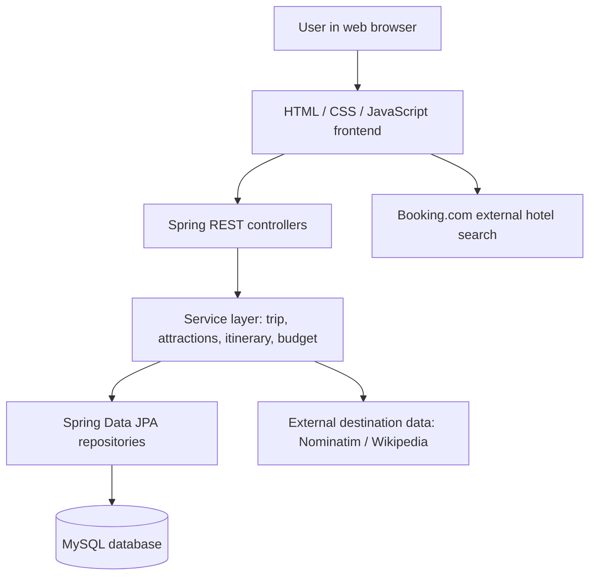
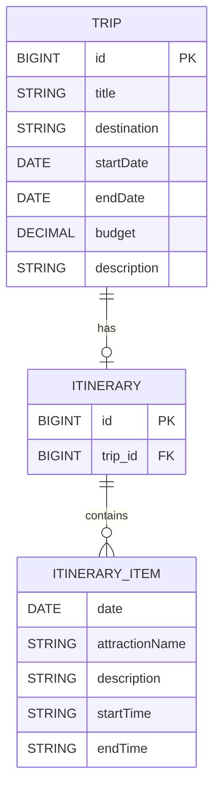
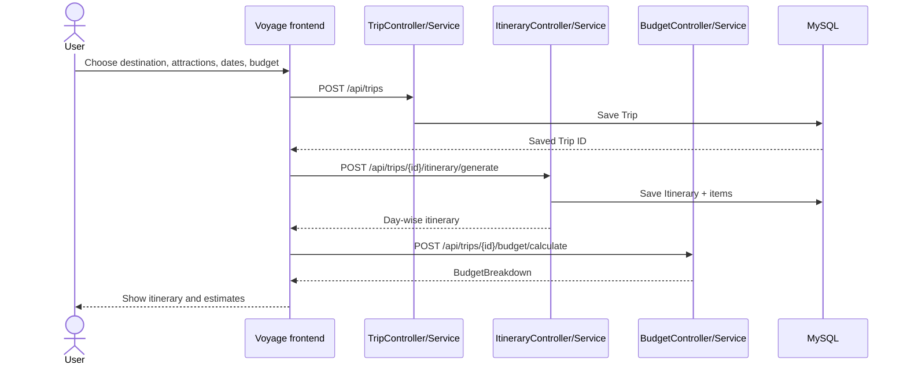

# Voyage — System Design

## Problem statement

Planning a trip often means switching between different websites to research a destination, decide which attractions to visit, estimate costs and find accommodation. Even a short itinerary can become difficult to organize when travel dates, available time and budget all need to be considered together.

**Voyage** brings these steps into a single planning flow. Users explore a destination, select attractions, set travel dates and a budget, and receive a structured day-wise itinerary. The application also estimates attraction expenses and directs users to an external hotel search with a suggested nightly budget.

## Design objectives

- Make basic trip planning straightforward through a simple web interface.
- Discover attractions dynamically rather than maintaining a fixed attractions database.
- Build day-wise schedules using approximate visit durations and rest breaks.
- Save trip details and generated itineraries so they persist in MySQL.
- Expose clear REST endpoints for trip management, itinerary generation and budget estimation.
- Handle invalid inputs and missing trip records predictably.

## Layered architecture

**Frontend:** Collects destinations, trip dates, selected attractions and budget; displays results and opens an external hotel-search page.  
**Controllers:** Map incoming HTTP requests to services and return JSON responses.  
**Services:** Hold business rules such as trip updates, attraction classification, itinerary scheduling and cost calculations.  
**Repositories:** Use `JpaRepository` to access persisted entities without handwritten CRUD SQL.  
**Database:** Stores trips and their generated itineraries.  
**Exception handler:** Uses `@RestControllerAdvice` to map application/validation exceptions to useful HTTP statuses.

## Entity relationship diagram

The `Trip` model is a JPA `@Entity` stored in `trips`. Each `Itinerary` references one Trip through `@OneToOne` and a unique `trip_id` foreign key. Its `items` are embedded value objects (`@Embeddable`) stored through `@ElementCollection` in a separate collection table. `ItineraryItem` does **not** have its own standalone entity ID. The exact collection-table name is determined by the JPA mapping/naming strategy.

**Budget data:** `BudgetBreakdown` is a calculated response record, not a separate persisted entity. `SelectedAttraction` and `AttractionResponse` are DTOs, not database entities.

## Main request flow

## Important design choices

**Category-based scheduling.** Each selected attraction carries a name and category. The category helps determine approximate visit time (for example, museums need less time than wildlife visits). Visits are distributed across trip dates, with lunch reserved from 1–2 PM and a 30-minute interval between stops. This is a practical estimate, not route optimization.

**Simple budget logic.** The backend sums estimated entry fees based on attraction category. It subtracts these expenses from the user's total budget to calculate the remaining hotel allowance. The frontend divides this by the number of hotel nights and passes the suggested nightly limit to a Booking.com search URL. The external website manages the actual hotel listings, prices and booking process.

**Separation of concerns.** Controllers focus on HTTP handling, services contain the business rules, and repositories handle persistence. This organization makes individual features easier to test and modify.

**Validation and error handling.** The Trip model uses Jakarta validation annotations; the application defines a custom `TripNotFoundException` and handles known problems centrally with `GlobalExceptionHandler`.

## Limitations and possible improvements

Visit lengths, category classifications and entry fees are estimates; the itinerary does not currently optimize travel distances or check live attraction opening times. The hotel search is an external hand-off, not a booking integration. A future version could add personalized accounts, more detailed transport/food costs and location-aware scheduling, but those are not required for the current prototype.
